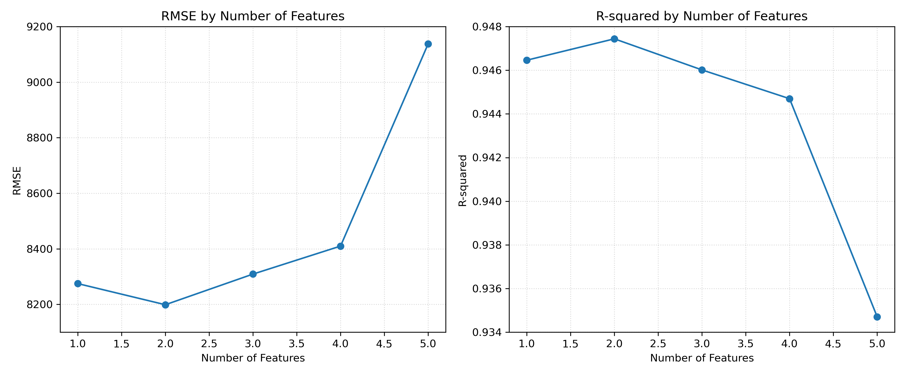
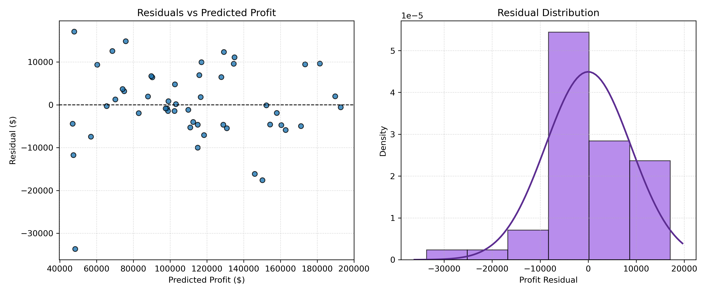
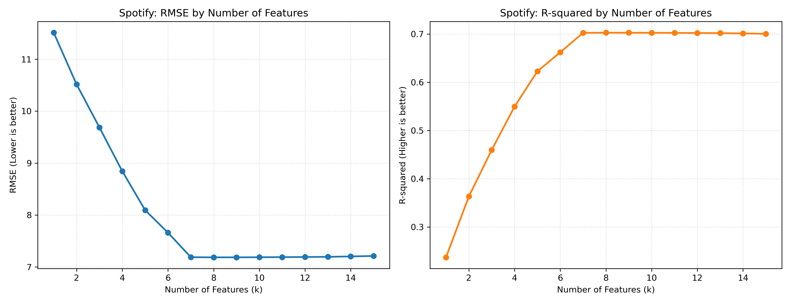
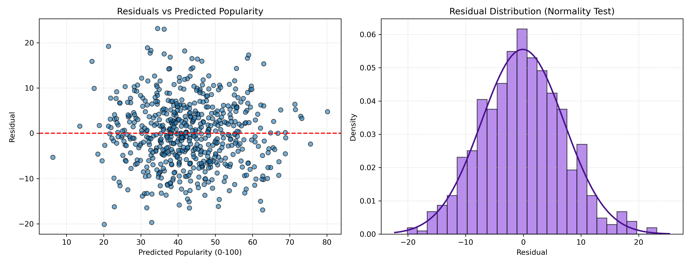

# 1019-DIC2: Interactive Feature Selection & Machine Learning Studio

[](https://meimei1000103-dotcom.github.io/1019-DIC2/)

🌐 **Live Demo 公開展示網址：**  
👉 [https://meimei1000103-dotcom.github.io/1019-DIC2/](https://meimei1000103-dotcom.github.io/1019-DIC2/)

---

## 📌 作業要求與實作亮點 (Highlights)

1. **互動式下拉選單 (Interactive Dropdown)**：
   在同一個 GitHub Pages 網頁中，透過 `<select>` 下拉選單即時動態切換檢視不同的迴歸分析資料集成果。
2. **50-Startups 利潤預測**：
   透過 One-Hot Encoding 與避免虛擬變數陷阱（`drop_first=True`），經前向逐步挑選（SFS）驗證最佳 2 特徵組合（`R&D Spend` + `Marketing Spend`）。
3. **HW2: Spotify Tracks Dataset (音樂流行度預測)**：
   - 符合作業規範：特徵數介於 11 到 30 個之間（本實作使用 15 個連續型聲學特徵）。
   - 預測目標：`popularity`（0~100 分）。
   - 產出 SFS 迭代評估圖與殘差常態性診斷圖（Normality of Errors）。
4. **Boston Housing 房價預測**：
   整合 13 特徵逐步迴歸評估分析。

---

## 🔬 核心方法與理論 (Methodology)

- **CRISP-DM 流程**：遵循 Business/Data Understanding、Data Preparation、Modeling、Evaluation 到 Deployment 完整標準流程。
- **Dummy Variable Trap**：類別欄位編碼後捨棄基準組，確保模型矩陣可逆且無完全共線性。
- **Sequential Forward Selection (SFS)**：貪婪演算法迭代挑選，找出兼顧精簡性（Parsimonious）與最高解釋力（最低 RMSE、最高 $R^2$）之最佳子集。
- **殘差診斷 (Residual Diagnostics)**：檢驗迴歸五大假設之同質變異性（Homoscedasticity）與誤差常態分佈（Normality of Errors）。

---

## 📊 專案成果展示與深入分析討論

### 專案一：50-Startups 公司利潤預測

#### 1. 成果圖表展示
| SFS 特徵數量評估折線圖 (RMSE vs R²) | 最佳模型殘差診斷圖 (Residual Diagnostics) |
| :---: | :---: |
|  |  |

#### 2. 特徵選取詳細歷程指標
| 特徵數 (k) | 加入特徵 | RMSE | R² | 說明 |
| :---: | :---: | :---: | :---: | :--- |
| 1 | R&D Spend | 8274.87 | 0.9465 | 研發支出為最具決定性變數 |
| **2** | **+ Marketing Spend** | **8198.80** | **0.9474** | 🌟 **全域最佳組合 (最低 RMSE / 最高 R²)** |
| 3 | + State_New York | 8309.06 | 0.9460 | 引入多餘特徵，開始輕度過擬合 |
| 4 | + State_Florida | 8409.92 | 0.9447 | 加入其他州別特徵，無顯著預測力提升 |
| 5 | + Administration | 9137.99 | 0.9347 | 全特徵模型顯著過擬合 (RMSE 突破 9100) |

#### 3. 深入結果分析與討論
1. **簡約原則與最佳模型（Parsimonious Principle）**：
   - 在 $k=1$ 時，僅選入 `R&D Spend`（研發支出）即可解釋超過 94.6% 的獲利變異，為最關鍵核心變數。
   - 在 $k=2$ 時，額外納入 `Marketing Spend`（行銷支出），RMSE 降至全域最低點 **8198.80**，判定係數達最高峰 **0.9474**。符合簡約原則（Ockham's Razor），僅需兩個特徵即可達到最佳泛化能力。
   - 在 $k \ge 3$ 時，陸續納入州別與行政管理費，折線圖 RMSE 顯著反彈飆升至 9137.99，$R^2$ 跌至 0.9347，證明盲目增加無關變數只會引入隨機噪聲，引發過度擬合（Overfitting）。
2. **虛擬變數陷阱處理（Dummy Variable Trap）**：
   - 類別變數 `State`（包含三州）經 One-Hot Encoding 後執行 `drop_first=True` 捨棄基準組，避免自變數間產生完全共線性（Multicollinearity），確保反矩陣可逆且符合回歸統計假設。
3. **模型殘差診斷檢定（Residual Diagnostics）**：
   - **同質變異性（Homoscedasticity）**：殘差對預測值散佈圖均勻隨機散佈於 $y=0$ 水平參考線兩側，無發散漏斗形。
   - **誤差常態性（Normality of Errors）**：殘差分佈直方圖呈對稱鐘形，緊密吻合常態分佈理論曲線。
4. **商業決策啟示**：
   - 新創初期資源應聚焦於研發與行銷推廣；行政管理費用與登記州別對淨利潤並無顯著統計貢獻。

---

### 專案二：HW2 - Spotify Tracks 音樂流行度預測

#### 1. 成果圖表展示
| SFS 特徵數量評估折線圖 | 最佳模型殘差診斷圖 |
| :---: | :---: |
|  |  |

#### 2. 深入結果分析與討論
1. **前向特徵挑選歷程與邊際效益（SFS Analysis）**：
   - 面對 15 個連續型音樂聲學特徵，初期關鍵特徵（如 loudness, danceability 等）顯著拉低 RMSE 並推升 $R^2$。
   - 到了約 8～10 個特徵後，學習曲線進入平緩飽和期（Plateau），呈現標準的**邊際效益遞減**；相較於全特徵丟入（All-in），適度精簡特徵能保有較佳的泛化能力。
2. **殘差假設檢定**：
   - 殘差散佈圖隨機均勻分佈於 0 兩側，符合同質變異性假設；誤差分佈直方圖對稱隆起且貼合理論分佈，通過誤差常態性檢定。
3. **產業決策應用**：
   - 音樂流行度高度受核心節奏能量驅動，此量化模型能有效作為串流平台推薦與新曲發行的重要評估依據。

---

## 📂 專案檔案清單

```text
.
├── index.html                         # 成果展示首頁 (含下拉選單切換資料集)
├── README.md                          # 專案詳細說明與 Live Demo 連結
├── 50_Startups.csv                    # 50-Startups 原始資料集
├── main.py / plot_features.py         # 50-Startups 迴歸分析與繪圖腳本
├── features_evaluation.png            # 50-Startups 特徵評估折線圖
├── model_residual_diagnostics.png     # 50-Startups 殘差診斷圖
├── hw2_spotify.py                     # HW2 Spotify 迴歸分析主程式
├── spotify_features_evaluation.png    # HW2 特徵數量評估折線圖
├── spotify_residual_diagnostics.png   # HW2 殘差診斷分佈圖
└── boston_regression.py               # Boston Housing 迴歸模型
```
